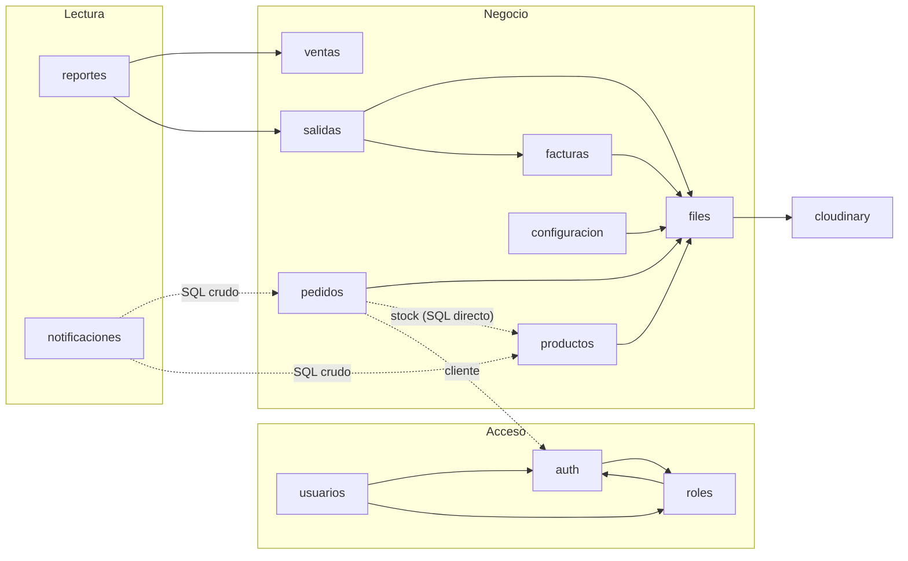

# Documentación por módulo

Mapa de contexto del backend de **Variedades ByJ** (NestJS 11 + TypeORM + PostgreSQL). Cada módulo tiene su archivo con:
qué hace, endpoints, permisos, reglas de negocio, modelo de datos, dependencias y trampas conocidas. Los archivos se
enlazan entre sí: si un módulo toca a otro, el enlace está en la sección **Relaciones**.

> Fuente de verdad: el código. Estos documentos describen el estado de `main` y se revisan cuando un módulo cambia.
> Para decisiones de arquitectura ver [`docs/adr/`](../adr/); para despliegue, [`docs/DEPLOY.md`](../DEPLOY.md).

## Índice

| Módulo                                       | Ruta base de la API                 | Qué hace                                                                   |
| -------------------------------------------- | ----------------------------------- | -------------------------------------------------------------------------- |
| [Auth](./auth.md)                            | `api/auth`                          | Login, registro, renovar token, guards y catálogo de permisos.             |
| [Roles](./roles.md)                          | `api/roles`                         | Roles configurables y los permisos que tiene cada uno.                     |
| [Usuarios](./usuarios.md)                    | `api/usuarios`                      | Listar usuarios y cambiarles el rol.                                       |
| [Productos](./productos.md)                  | `api/productos`                     | Catálogo, fotos, stock y stock mínimo.                                     |
| [Pedidos y ventas del sistema](./pedidos.md) | `api/pedidos`, `api/ventas-sistema` | Pedidos de la tienda en línea, ventas de mostrador y comprobantes.         |
| [Ventas (cierre diario)](./ventas.md)        | `api/ventas`                        | Cierre de caja de cada día (no son las ventas del sistema).                |
| [Salidas](./salidas.md)                      | `api/salidas`                       | Pagos y abonos del negocio (de una factura o libres) con soportes.         |
| [Facturas](./facturas.md)                    | `api/facturas`                      | Facturas de proveedor (libre, plazo o cuotas), saldos y resumen de deudas. |
| [Reportes](./reportes.md)                    | `api/reportes`                      | Resumen de ventas vs. salidas en un rango de fechas.                       |
| [Notificaciones](./notificaciones.md)        | `api/notificaciones`                | Avisos del panel calculados al momento.                                    |
| [Configuración](./configuracion.md)          | `api/configuracion`                 | Datos del negocio (una sola fila) y logo.                                  |
| [Files y Cloudinary](./files-cloudinary.md)  | — (interno)                         | Subida/borrado de imágenes y PDFs, límites y interceptores.                |
| [Common](./common.md)                        | — (interno)                         | DTOs, rangos de fecha y seguridad compartidos.                             |
| [Base de datos](./base-de-datos.md)          | — (interno)                         | Esquema, migraciones, convenciones y datos sembrados.                      |
| [Arranque, config y health](./arranque.md)   | `api/health`                        | `main.ts`, variables de entorno, throttling, CORS, Swagger.                |

## Mapa de dependencias

Línea continua = importa el módulo/entidad en TypeScript. Línea punteada = acoplamiento por datos (entidad compartida,
SQL directo o constantes importadas). Todos los módulos con endpoints protegidos dependen del decorador
`@Autorizar` de [auth](./auth.md).

## Convenciones transversales (aplican a todos los módulos)

- **Arquitectura**: `controller → service → entidad TypeORM`, DTOs en `dtos/`. La lógica va en el service.
- **Validación**: `ValidationPipe` global con `whitelist`, `forbidNonWhitelisted` y `transform` (ver [arranque](./arranque.md)).
  Un campo no declarado en el DTO responde 400.
- **Autorización**: todo endpoint de escritura lleva `@Autorizar(Permiso.X)`. `@Autorizar()` sin permisos = «basta con
  tener sesión». Los permisos se leen de la BD en cada petición ([auth](./auth.md)).
- **Dinero**: pesos colombianos **enteros** (`integer`), nunca decimales. Tope habitual `2_000_000_000`.
- **Fechas**: día de negocio = `date` como texto `YYYY-MM-DD`; instantes = `timestamptz` en UTC. Día de hoy en hora de
  Colombia con `hoyNegocio()` ([facturas](./facturas.md)). Ver [ADR 0002](../adr/0002-fechas-como-date-y-timestamptz.md).
- **Imágenes**: tabla hija por entidad y API `imagenes: [{ publicId, url }]`. Ver [files-cloudinary](./files-cloudinary.md) y
  [ADR 0003](../adr/0003-imagenes-en-tablas-hijas.md).
- **Multipart**: crear/editar con archivos usa `multipart/form-data`; todo llega como texto, por eso los DTOs usan `@Type(() => Number)`.
  Al editar, `conservar` lista los `publicId` que se quedan.
- **Errores concurrentes**: la violación de índice único (`23505` de Postgres) se traduce a `409 Conflict`.
  Los cambios sensibles se hacen en **una sentencia SQL** o transacción (stock, estado de pedido, saldo de factura) para que
  dos peticiones simultáneas no se pisen.
- **Listados paginados**: `{ datos, total, pagina, limite }` con `pagina` desde 1 y `limite` máx. 100 (por defecto 20).
- **Mensajes de error**: en español, dirigidos al usuario final.
- **Verificaciones**: no correr tests/build/lint salvo orden explícita ("corre los tests"). Ver `CLAUDE.md`.

## Glosario

| Término                   | Significado                                                                                                    |
| ------------------------- | -------------------------------------------------------------------------------------------------------------- |
| **Cierre diario**         | Fila de `ventas`: totales de piñatería y papelería de un día. Módulo [ventas](./ventas.md).                    |
| **Venta del sistema**     | Un [pedido](./pedidos.md) en estado `entregado` (de la web o del mostrador), con número de comprobante `CV-…`. |
| **Salida**                | Dinero que sale del negocio (compra o pago). Módulo [salidas](./salidas.md).                                   |
| **Factura**               | Factura de compra a un proveedor, con modalidad libre/plazo/cuotas. Módulo [facturas](./facturas.md).          |
| **Mostrador**             | Canal de venta presencial (`canal = mostrador`); el vendedor la registra ya entregada.                         |
| **Piñatería / Papelería** | Las dos líneas del negocio; el cierre diario las separa.                                                       |
| **Rol de sistema**        | `admin` y `cliente` (columna `clave`); no se editan ni borran. Ver [roles](./roles.md).                        |
| **Soporte**               | Imagen o PDF adjunto a una salida/factura (comprobante, foto de la factura).                                   |

## Frontend

El repo hermano `../Variedades-ByJ-2.0-web` consume esta API. Si un cambio toca el contrato (rutas, cuerpos, permisos), hay
que actualizar también el front, con rama y PR propios (ver `CLAUDE.md`, sección _Frontend_).
